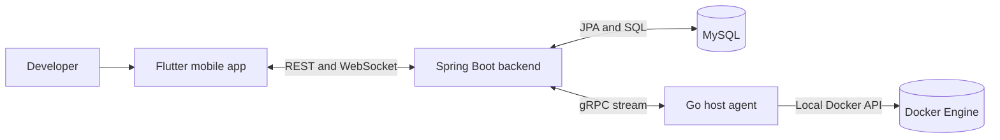

# PocketOps

PocketOps is a mobile-first infrastructure monitoring and control project for developers running Dockerized services. Its Flutter app provides an at-a-glance view of connected infrastructure and discovered containers, while a Spring Boot backend coordinates authentication, state, and communication with a small Go agent installed on a Docker host.

The project is intended to make common operational checks and a small set of corrective actions available from a phone. It is not a remote shell, a general-purpose Docker API proxy, or a full observability platform.

## Contents

- [What it does](#what-it-does)
- [Current implementation](#current-implementation)
- [Architecture](#architecture)
- [Repository layout](#repository-layout)
- [Requirements](#requirements)
- [Run locally](#run-locally)
- [Configuration](#configuration)
- [Tests and checks](#tests-and-checks)
- [API overview](#api-overview)
- [Security notes](#security-notes)
- [Project documentation](#project-documentation)

## What it does

- Authenticates users with email and password; the backend also has a GitHub OAuth code-exchange endpoint.
- Creates and lists user-owned infrastructures, with separate `SELF_HOSTED` and `MANAGED` types.
- Connects self-hosted infrastructure through a standalone Go agent. The agent registers with a one-time token, stores its persistent identity locally, and connects to the backend over gRPC.
- Discovers Docker containers and sends snapshots, heartbeats, and live metrics to the backend.
- Displays infrastructure and container state in the Flutter application and supports the allow-listed container actions: start, stop, and restart.
- Uses REST for request/response operations and WebSockets for infrastructure and resource updates.

Managed infrastructure records can be created, but provider adapters are not implemented yet. The product and architecture documents describe the larger intended scope; see [Current implementation](#current-implementation) for what is present in code today.

## Current implementation

The repository contains a working foundation and self-hosted monitoring path. The documented implementation roadmap marks host discovery and live monitoring as in progress; features described in the frozen product documents should not automatically be assumed to be complete.

| Area | Available in the current code |
|---|---|
| Mobile app | Flutter app with authentication UI, backend health check, infrastructure list/create flow, resource details, live updates, and container action controls. |
| Backend | Spring Boot modular monolith with MySQL persistence, Flyway migrations, email/password auth, JWT access and refresh tokens, session management, infrastructure ownership checks, agent registration, gRPC, monitoring updates, and WebSocket endpoints. |
| Go agent | Standalone Docker-host agent with one-time registration, saved identity, heartbeats, container snapshots and metrics, reconnect behavior, and allow-listed start/stop/restart commands. |
| Shared contract | Protobuf service and messages for agent/backend streaming in `proto/pocketops_agent.proto`. |

Not yet implemented as a complete product flow: managed-provider integrations, live log streaming, alert lifecycle and push notifications, and the Android home-screen widget. GitHub OAuth requires provider credentials and redirect configuration; the current Flutter UI accepts an authorization code rather than launching a complete browser-based OAuth flow.

## Architecture



- **Flutter / Dart** is the mobile client. Riverpod manages application state; secure storage is used for auth tokens.
- **Spring Boot / Java 21** is a single deployable backend (a modular monolith), not a set of microservices.
- **MySQL** stores users, sessions, infrastructures, agents, and discovered resources. Flyway applies schema migrations at startup.
- **Go** runs as a separate process on the machine hosting Docker. It observes the local Docker Engine and maintains a bidirectional gRPC stream to the backend.
- **Protocol Buffers** define the agent/backend gRPC contract and are compiled during the backend Maven build.

## Repository layout

```text
.
├── agent/                  # Go host agent
│   ├── commands/           # Allow-listed Docker operations
│   ├── config/             # Flags, environment and saved identity
│   ├── connection/         # gRPC stream, reconnect, heartbeat and samples
│   ├── docker/             # Local Docker Engine client
│   └── registration/       # One-time registration HTTP client
├── backend/                # Spring Boot backend
│   └── src/
│       ├── main/java/      # auth, session, infrastructure, agent, monitoring, etc.
│       ├── main/resources/ # application configuration and Flyway migrations
│       └── test/java/      # backend integration and flow tests
├── docs/                   # Product, architecture, design and project status
├── pocketops/              # Flutter mobile application
│   ├── lib/core/           # Configuration, routing, theme and networking
│   ├── lib/features/       # Auth, home, infrastructure and service details
│   └── test/               # Flutter tests
├── proto/                  # Shared Protocol Buffers definitions
├── docker-compose.yml      # Local MySQL and backend services
└── .env.example            # Local MySQL Compose variables
```

## Requirements

- **Java 21 JDK** for the backend.
- **Flutter SDK** with Dart 3.7 or later (the app declares Dart `^3.7.0`).
- **Go 1.25 or later** as specified in `agent/go.mod`.
- **Docker Engine and Docker Compose** for the local database and for monitoring containers with the agent.
- A Docker daemon accessible to the Go agent.

## Run locally

The commands below use PowerShell on Windows. On macOS/Linux, use `./mvnw` in place of `.\mvnw.cmd` and adapt the Flutter API URL for the target device.

### 1. Start MySQL

From the repository root:

```powershell
Copy-Item .env.example .env
docker compose up -d mysql
```

The example file contains development-only MySQL credentials. Do not use these values outside a local development environment. The Compose service publishes MySQL on port `3306` and stores its data in the `pocketops-mysql-data` named volume.

### 2. Start the backend

In a separate terminal:

```powershell
Set-Location backend
.\mvnw.cmd spring-boot:run
```

The backend listens on HTTP port `8080` and gRPC port `9090` by default. Flyway applies the migrations from `backend/src/main/resources/db/migration` on startup. Check backend and database health with:

```powershell
Invoke-RestMethod http://localhost:8080/api/health
```

The local database defaults in `application.properties` match `.env.example`. If you change the MySQL values, set `POCKETOPS_DB_USERNAME` and `POCKETOPS_DB_PASSWORD` in the backend process environment as well.

### 3. Run the Flutter app

```powershell
Set-Location pocketops
flutter pub get
flutter run --dart-define=POCKETOPS_API_BASE_URL=http://10.0.2.2:8080
```

`10.0.2.2` is the Android Emulator address for services running on the development host. For a target running on the same machine as the backend, use `http://localhost:8080`; for a physical phone, use the development machine's reachable LAN address. The app has a compiled-in default API URL, so set `POCKETOPS_API_BASE_URL` when connecting to a different backend.

Create an account in the app, sign in, and open **Infrastructures** to create a self-hosted infrastructure. The app displays the one-time agent installation command after creation.

### 4. Build and run the Go agent

From the repository root, build the agent:

```powershell
Set-Location agent
go build -o pocketops-agent.exe .
```

Run the generated binary on the machine whose Docker containers you want to monitor, using the one-time registration token from the app:

```powershell
.\pocketops-agent.exe `
  --backend http://<backend-host>:8080 `
  --grpc <backend-host>:9090 `
  --token <one-time-registration-token> `
  --insecure-dev
```

Replace `<backend-host>` with an address reachable **from the Docker host**. For a local setup on one machine, use `localhost`; if the agent is on another host, use the backend host's network address. `--insecure-dev` enables plaintext gRPC and is only for local development; use TLS for non-local deployments. The agent saves its persistent identity to `~/.pocketops-agent.json` by default, so later runs can reconnect without the one-time token.

To run both Compose services, first add these backend settings to `.env` (the checked-in example currently lists only the MySQL values):

```dotenv
POCKETOPS_PUBLIC_BASE_URL=http://localhost:8080
POCKETOPS_AGENT_GRPC_HOST=localhost
POCKETOPS_AGENT_GRPC_PORT=9090
```

Then run `docker compose up -d`. The backend service publishes ports `8080` and `9090`. If the agent runs on a different machine, set `POCKETOPS_PUBLIC_BASE_URL` and `POCKETOPS_AGENT_GRPC_HOST` to addresses reachable from that machine. Check that both ports are reachable from the agent host before attempting registration.

## Configuration

### Backend

Configuration is read from Spring properties and environment variables. Common settings:

| Environment variable | Default | Purpose |
|---|---|---|
| `POCKETOPS_SERVER_PORT` | `8080` | HTTP port |
| `POCKETOPS_DB_URL` | Local MySQL URL | JDBC database connection |
| `POCKETOPS_DB_USERNAME` | `pocketops` | Database user |
| `POCKETOPS_DB_PASSWORD` | Configured by local environment | Database password |
| `POCKETOPS_AUTH_JWT_ISSUER` | `pocketops` | JWT issuer |
| `POCKETOPS_AUTH_JWT_SECRET` | Development placeholder | JWT signing secret; set a strong secret for any non-local use |
| `POCKETOPS_AUTH_ACCESS_MINUTES` | `15` | Access-token lifetime |
| `POCKETOPS_AUTH_REFRESH_DAYS` | `30` | Refresh-token lifetime |
| `POCKETOPS_PUBLIC_BASE_URL` | `http://localhost:8080` | Backend URL included in agent setup details |
| `POCKETOPS_AGENT_GRPC_HOST` | `localhost` | gRPC address returned to registering agents |
| `POCKETOPS_AGENT_GRPC_PORT` | `9090` | gRPC listener/advertised port |
| `POCKETOPS_AGENT_GRPC_TLS_ENABLED` | `false` | Enable server-side gRPC TLS |
| `POCKETOPS_AGENT_GRPC_TLS_CERT_CHAIN_PATH` | Empty | TLS certificate chain file |
| `POCKETOPS_AGENT_GRPC_TLS_PRIVATE_KEY_PATH` | Empty | TLS private key file |
| `POCKETOPS_AGENT_REGISTRATION_TOKEN_MINUTES` | `30` | One-time registration credential lifetime |
| `POCKETOPS_AGENT_HEARTBEAT_TIMEOUT_SECONDS` | `45` | Agent timeout before marking it offline |

Database schema changes belong in new Flyway migration files; Hibernate is configured to validate rather than create or update the schema.

### Agent

The agent accepts command-line flags and selected environment variables. Useful flags include `--backend`, `--grpc`, `--token`, `--config`, `--heartbeat-interval`, `--metrics-interval`, `--snapshot-interval`, and `--insecure-dev`. Environment-based defaults include `POCKETOPS_BACKEND_URL`, `POCKETOPS_AGENT_GRPC`, `POCKETOPS_REGISTRATION_TOKEN`, `POCKETOPS_AGENT_VERSION`, and `POCKETOPS_AGENT_CONFIG`. Defaults and validation are defined in `agent/config/config.go`. The identity configuration file contains sensitive credentials; protect it and do not commit or share it.

## Tests and checks

Run the checks from each component directory:

```powershell
# Backend (Java 21)
Set-Location backend
.\mvnw.cmd test

# Go agent
Set-Location ..\agent
go test ./...
go build ./...

# Flutter
Set-Location ..\pocketops
flutter pub get
flutter analyze
flutter test
```

Backend tests cover authentication/session behavior, infrastructure ownership, and agent registration/stream behavior. Go tests cover agent configuration and registration. Flutter tests cover auth UI/token storage and infrastructure API behavior.

## API overview

The backend uses JSON over HTTP under `/api`. Authenticated endpoints require a PocketOps access token unless they are specifically used for initial authentication or agent registration.

| Endpoint | Purpose |
|---|---|
| `GET /api/health` | Backend and database health check |
| `POST /api/auth/register` | Create an email/password account |
| `POST /api/auth/login` | Sign in |
| `POST /api/auth/github` | Exchange a GitHub authorization code |
| `POST /api/auth/refresh` | Rotate a refresh token |
| `POST /api/auth/logout`, `POST /api/auth/logout-all` | Revoke the current or all sessions |
| `GET /api/sessions`, `DELETE /api/sessions/{sessionId}` | List or revoke sessions |
| `GET/POST /api/infrastructures` | List or create infrastructures |
| `GET/DELETE /api/infrastructures/{id}` | Read or delete an owned infrastructure |
| `GET /api/infrastructures/{id}/resources` | List discovered resources |
| `POST /api/infrastructures/{id}/resources/{resourceId}/actions` | Request an allow-listed resource action |
| `POST /api/infrastructures/{id}/agent-registration` | Create a one-time agent registration credential |
| `POST /api/agents/register` | Exchange the credential for an agent identity |
| `POST /api/infrastructures/{id}/agent/revoke` | Revoke the infrastructure's agent |
| `ws://<host>:8080/ws/infrastructures/{infrastructureId}?token=<access-token>` | Subscribe to infrastructure updates |

The agent connection is the bidirectional gRPC `AgentControl/Connect` stream defined by the Protobuf contract. Infrastructure and resource endpoints enforce ownership in the backend.

## Security notes

- Never expose the Docker daemon API publicly. The agent should communicate with the local Docker Engine only.
- Keep JWT secrets, database credentials, OAuth credentials, registration tokens, agent identity files, and production TLS keys out of source control and logs.
- Change the development JWT signing secret before using a non-local environment. Do not rely on the default placeholder.
- The agent's `--insecure-dev` option disables transport encryption and must only be used for local testing.
- Agent registration tokens are intended for one-time setup. After registration, the agent uses its saved identity.
- Container control is limited to start, stop, and restart; PocketOps is not designed to provide shell access or arbitrary command execution.
- Treat the current Compose credentials and default configuration as development-only.

## Project documentation

The `docs/` directory is the detailed source for requirements and implementation decisions:

- [PRD.md](docs/PRD.md) — product vision, scope, requirements, and acceptance criteria.
- [ARCHITECTURE.md](docs/ARCHITECTURE.md) — system components, boundaries, and communication patterns.
- [DESIGN.md](docs/DESIGN.md) — domain model, API/message contracts, and UX behavior.
- [PHASES.md](docs/PHASES.md) — ordered implementation roadmap.
- [RULES.md](docs/RULES.md) — security and architecture constraints.
- [MEMORY.md](docs/MEMORY.md) — current implementation state and project decisions.
- [proto/README.md](proto/README.md) — shared agent protocol notes.
